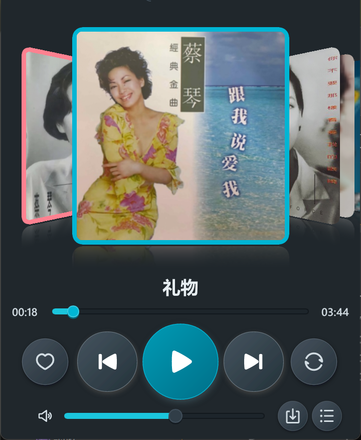
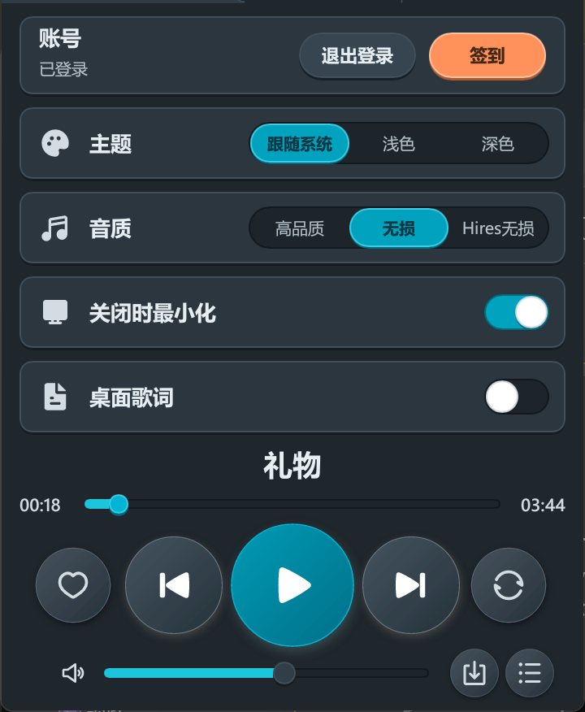

<div align="center">


# KoDogMusic

*在Windows上纯粹而优雅地听歌*


</div>

---

KoDogMusic是酷狗概念版的Windows第三方客户端。相比于其他基于Web的客户端，本端在界面精美的同时实现了全程低于60MB的内存占用，核心功能依然保留。

<p align="center">
  
  
</p>

## 快速开始

将以下指令发给具备终端执行能力的编程助手：

```text
帮我安装这个仓库：https://github.com/yourpapayouknow/KoDogMusic。
```

---

## 传统开始

需要Windows10/11 x64。

从[Releases](https://github.com/yourpapayouknow/KoDogMusic/releases/latest)下载`KoDogLite-v0.1.1.exe`。

1. 双击运行，无需安装。
2. 使用酷狗概念版App扫描窗口中的二维码登录。
3. 在设置中选择音质、主题和关闭行为。

如果要从源码构建，需要Rust1.92或更高版本和MSVC工具链：

```powershell
git clone https://github.com/yourpapayouknow/KoDogMusic.git
cd KoDogMusic
cargo build --release -p kugou-lite
```

---

## 功能

| 功能 | 用途 |
| --- | --- |
| 扫码登录 | 使用酷狗概念版App扫码，不支持账密登录 |
| 搜索与播放 | 搜索歌曲、歌手或专辑，点击结果播放 |
| CoverFlow | 「我喜欢」、每日推荐和收藏歌单以封面卡片排列，拖动或滚动切换 |
| 云端歌单 | 新建歌单、添加或移除歌曲、删除自建歌单 |
| 下载与离线 | 下载单曲、专辑或歌单，下载后可离线播放 |
| 桌面歌词 | 独立窗口，可拖动并保持置顶 |
| 签到 | 在设置页签到领会员 |
| 关闭时最小化 | 关闭主窗口后继续在托盘播放 |

---

## 使用

1. 首次打开后，使用酷狗概念版App扫描窗口中的二维码登录。信息放在AppData里面。
2. 在搜索页输入歌曲、歌手或专辑名，点击结果播放；底部控制器可调整进度、音量和循环模式。
3. 在收藏页打开「我喜欢」或歌单，点击歌曲播放；歌单支持新建、加歌和移除。
4. 点击播放器右下角的下载按钮，选择单曲或专辑/歌单并确认品质。下载目录可在设置中修改。
5. 在设置中开启桌面歌词，把歌词窗口拖到需要的位置；开启“关闭时最小化”后，关闭主窗口会继续在通知区播放。
6. 详情可以自行探索。