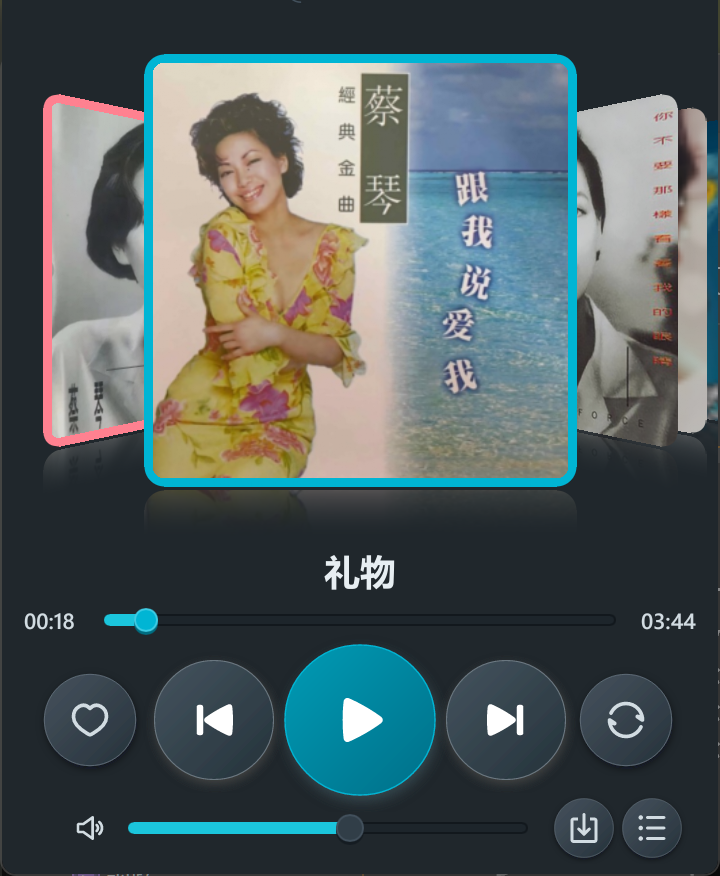
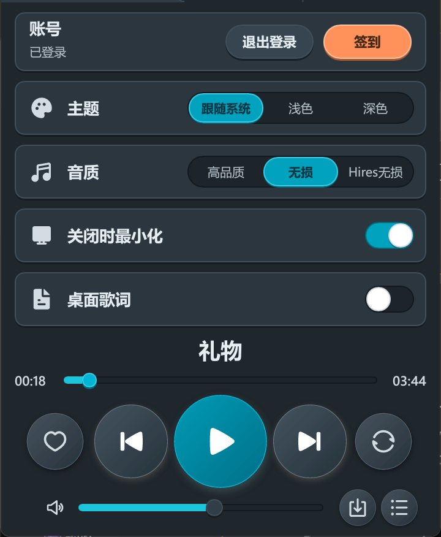

<div align="center">


# KoDogMusic

A lightweight third-party Windows client for Kugou Concept, with CoverFlow, cloud playlists, and desktop lyrics.

[简体中文](README.md) · [Download](../../releases/latest)


</div>

<p align="center">
  
  
</p>

KoDogMusic is written in Rust and Slint; it does not use a WebView, and the UI is rendered directly by Slint. The window is fixed at 360×480, with the account bar and Search, Favorites, and Settings tabs at the top and the player controls at the bottom. After signing in by scanning a QR code, you can search, play, manage cloud playlists, download tracks, and show lyrics on the desktop; with playback and desktop lyrics enabled, the working set is about 52.6 MB.

> [!NOTE]
> This is an unofficial client and is not affiliated with Kugou or Tencent. Music rights belong to their respective owners; please support the official service.

## Quick Start

Give the repository link to your coding agent, then say:

```text
Install this repository: use KoDogLite-v0.1.1.exe from the latest release if available; otherwise build from source, and put kugou-lite.exe in a convenient folder.
```

## Traditional Start

For Windows 10/11 x64.

1. Download `KoDogLite-v0.1.1.exe` from [Releases](../../releases/latest).
2. Double-click to run; no installation is required.
3. Scan the QR code in the window with the Kugou Concept app.
4. Adjust quality, theme, and close behavior in Settings.

## Features

- Account: sign in by scanning a QR code with the Kugou Concept app; the session is stored locally, and you can check in manually each day.
- Playback: Standard, High, Lossless, and Hi-Res according to account permissions and the quality actually available for the source; seek, volume, repeat, shuffle, and automatic next track.
- CoverFlow: Liked Songs, Daily Recommendations, saved playlists, and recommended playlists arranged as cover cards; drag or scroll to switch.
- Search and albums: search songs, artists, and albums; results can be played, added to the queue, or opened in the album view.
- Favorites and playlists: read and write cloud playlists, create playlists, add or remove tracks, and delete your own playlists; fall back to local favorites with a clear source label when the API is unavailable.
- Queue: view, play, remove, and clear the current queue; it is restored after a restart.
- Downloads: download tracks, albums, or playlists at the selected quality, with lyric export; downloaded lossless files are preferred for playback.
- Desktop lyrics: enable it in Settings to show a separate single-line window, draggable and always on top, following actual playback progress.
- Appearance and settings: light, dark, or system; with "Close to tray" enabled, closing the main window hides it to the notification area and playback continues; cache and download folders can be changed.

## Controls

Drag left or right, or scroll, over the cover area to switch CoverFlow, and click a cover to play. Click the queue icon at the bottom right to view the current queue. Click the "…" button next to a track to play next, add to queue, favorite, download, or view its album. Click the account avatar or the track title to return to the player.

## Download and Offline Playback

The download button at the bottom right of the player first queries the quality actually available for the current track or collection, then asks you to choose. Files are saved in a subfolder named after the album or playlist, under `KoDogLite` in the Windows Downloads folder by default; single tracks go into their album folder, and tracks without an album name use "Artist - Title" as the folder name. Lyrics can be exported separately as `.lrc` files.

Downloaded audio is recorded in a local index. When the same track is played later, a local lossless file takes priority; when the network is unavailable, playback falls back to any downloaded copy.

## Build from Source

Windows 10/11 x64, Rust 1.92 or newer, and the MSVC toolchain.

```powershell
git clone https://github.com/yourpapayouknow/KoDogMusic.git
cd KoDogMusic
cargo build --release -p kugou-lite
```

The executable is `target\release\kugou-lite.exe`. Build the diagnostics CLI with `cargo build --release -p kgctl`.

## Verification

```powershell
cargo test --workspace
```

## Project Layout

| Path | Purpose |
| --- | --- |
| `apps/desktop/` | Slint UI, windows, CoverFlow, and Windows integration |
| `crates/core/` | Domain model, use-case coordinator, providers, audio, and storage |
| `cli/` | `kgctl` diagnostics tool |
| `docs/` | Architecture, scope, and release assets |
| `vendor/` | Patched Slint software renderer |
| `tools/` | Memory sampling scripts |

## Technical Notes

- UI: Slint 1.18.1 + winit, software rendering, no WebView.
- Audio: Symphonia decoding, CPAL output, rubato resampling.
- Networking and storage: reqwest, rusqlite.
- Memory: release working set target under 60 MB.

## Acknowledgements

Slint: UI and software rendering; winit: windowing and event loop; Symphonia: audio decoding; CPAL: audio output; rubato: resampling; rusqlite: local storage; reqwest: networking; MingCute: icons.

## Notes

Login credentials are encrypted with Windows DPAPI and stored in `%LOCALAPPDATA%\KoDogLite`; the queue, favorites, and settings live in the same folder. The app does not collect telemetry. Audio quality depends on account permissions and the version actually provided by the source; the upstream API is controlled by Kugou and may change. MIT licensed; `vendor/slint-renderer-software` is patched upstream code and keeps its upstream license.
